<div align="center">

<picture>
  <source media="(prefers-color-scheme: dark)" srcset="assets/examples/hero-dark.svg" />
  
</picture>

# Awesome Git Stats

**Beautiful, animated stat cards for your GitHub profile README: stars, streaks, a contribution
heatmap, a 3D skyline, rank, languages and more: 16 layouts in 122 themes that follow GitHub's light and dark mode.**

[](https://github.com/iiogurt/Awesome-Git-Stats/actions/workflows/ci.yml)
[](https://github.com/iiogurt/Awesome-Git-Stats/releases)
[](https://nodejs.org)
[](package.json)
[](LICENSE)

[**Quick start**](#quick-start-github-action) ·
[**Deploy on Vercel**](#host-your-own-instance-on-vercel) ·
[**Layouts**](#layouts) ·
[**Themes**](docs/themes.md) ·
[**Options**](#options) ·
[**FAQ**](#troubleshooting-and-faq)

</div>

> [!TIP]
> The card above switches between a night sky and a dawn sky when you change your GitHub
> appearance setting (**Settings → Appearance**). Yours can do the same.

## Contents

- [Features](#features)
- [How it works: pick one of two ways](#how-it-works-pick-one-of-two-ways)
- [Quick start: GitHub Action](#quick-start-github-action) (no hosting, 5 minutes)
- [Host your own instance on Vercel](#host-your-own-instance-on-vercel) (live link, 10 minutes)
- [Layouts](#layouts)
- [Themes and light/dark mode](#themes)
- [Options](#options)
- [Troubleshooting and FAQ](#troubleshooting-and-faq)
- [Command line](#command-line) · [Development](#development) · [Versioning](#versioning) ·
  [Acknowledgements](#acknowledgements) · [License](#license)

## Features

| Feature                        | What you get                                                                                                                                                                                                 |
| ------------------------------ | ------------------------------------------------------------------------------------------------------------------------------------------------------------------------------------------------------------ |
| **16 layouts**                 | Overview, stats with a rank, languages (bars, donut, pie, waffle), pinned repos and gists, streak, heatmap, a **3D skyline**, radar, treemap, timeline, a goal that fills up, a full **dashboard** and more. |
| **60 designs, 122 themes**     | Every design comes in a matching light and dark variant. 45 artistic designs with generated background art: nature, smooth and flowing, holidays, anime, horror, 3D and bold, heavily animated styles.       |
| **Follows GitHub's dark mode** | Visitors see the light or dark card according to their own GitHub appearance setting.                                                                                                                        |
| **Unique art**                 | 45 art styles, generated from your username: nobody else has your starfield, forest or fireworks.                                                                                                            |
| **No hosting needed**          | A GitHub Action renders the card on a schedule and commits it to your repository. Prefer a live link? Deploy your own instance to Vercel's free plan in minutes.                                             |
| **Accessible and robust**      | Animations from calm to bold that stop for people who prefer reduced motion, readable contrast in every theme, and an on-theme error card instead of a broken image.                                         |
| **Users and organizations**    | Works for any public GitHub account.                                                                                                                                                                         |

<table>
  <tr>
    <td>
      <picture>
        <source media="(prefers-color-scheme: dark)" srcset="assets/examples/theme-synthwave.svg" />
        
      </picture>
    </td>
    <td>
      <picture>
        <source media="(prefers-color-scheme: dark)" srcset="assets/examples/theme-sakura_dark.svg" />
        
      </picture>
    </td>
  </tr>
  <tr>
    <td>
      <picture>
        <source media="(prefers-color-scheme: dark)" srcset="assets/examples/theme-blueprint.svg" />
        
      </picture>
    </td>
    <td>
      <picture>
        <source media="(prefers-color-scheme: dark)" srcset="assets/examples/theme-northern_lights.svg" />
        
      </picture>
    </td>
  </tr>
  <tr>
    <td>
      <picture>
        <source media="(prefers-color-scheme: dark)" srcset="assets/examples/theme-anime_sky_dark.svg" />
        
      </picture>
    </td>
    <td>
      <picture>
        <source media="(prefers-color-scheme: dark)" srcset="assets/examples/theme-hologram.svg" />
        
      </picture>
    </td>
  </tr>
  <tr>
    <td>
      <picture>
        <source media="(prefers-color-scheme: dark)" srcset="assets/examples/theme-halloween.svg" />
        
      </picture>
    </td>
    <td>
      <picture>
        <source media="(prefers-color-scheme: dark)" srcset="assets/examples/theme-inferno.svg" />
        
      </picture>
    </td>
  </tr>
</table>

<p align="center"><sub>Switch your GitHub appearance setting and these cards switch with it. More designs in the
<a href="docs/themes.md">theme gallery</a>.</sub></p>

## How it works: pick one of two ways

A README can only show images. Something has to ask the GitHub API for your numbers and draw
the image, and there are two places where that can happen:

|                     | **1. GitHub Action** (recommended)                 | **2. Live link**                                      |
| ------------------- | -------------------------------------------------- | ----------------------------------------------------- |
| **What you set up** | One workflow file in your profile repository       | Your own deployment on Vercel (free plan)             |
| **Hosting**         | None. GitHub Actions runs it for free              | A small serverless function on Vercel                 |
| **Token**           | None, the workflow's built-in token is used        | A GitHub token with no permissions                    |
| **Card updates**    | On your schedule, for example once a day           | When viewed, cached for a few hours                   |
| **In your README**  | ``                       | ``   |
| **Best for**        | Your own profile: simplest and nothing can go down | Sharing one instance with others, faster updates      |
| **Setup guide**     | [Quick start](#quick-start-github-action)          | [Deploy on Vercel](#host-your-own-instance-on-vercel) |

Star counts change slowly, so for a personal profile the Action is the easiest and most
reliable choice. You can always switch later.

> [!NOTE]
> Services such as github-readme-stats work the second way: their maintainers pay for and run
> one public instance for everybody. That is why you don't host anything with them, and why their
> cards break for everyone when that instance hits GitHub's limits. Here, every instance is yours.

## Quick start: GitHub Action

You'll create a workflow that draws your card once a day and saves it as an image file in your
profile repository. You need nothing but a GitHub account.

### Step 1: Create your profile repository

Your profile README lives in a special public repository named exactly like your username.

1. Go to **[github.com/new](https://github.com/new)**.
2. Under **Repository name**, type your username exactly (for `octocat`, the name is `octocat`).
   GitHub confirms with _"You found a secret!"_.
3. Choose **Public** and tick **Add a README file**.
4. Click **Create repository**.

Already have one? Open it and continue with step 2.

### Step 2: Add the workflow

1. In your profile repository, click **Add file → Create new file**.
2. Name the file `.github/workflows/stars.yml` (typing the `/` creates the folders).
3. Paste this:

   ```yaml
   name: Update stars card

   on:
     schedule:
       - cron: '0 3 * * *' # every day at 03:00 UTC
     workflow_dispatch: # adds a "Run workflow" button

   permissions:
     contents: write # lets the workflow commit the card

   jobs:
     card:
       runs-on: ubuntu-latest
       steps:
         - uses: actions/checkout@v7
         - uses: iiogurt/Awesome-Git-Stats@v1
           with:
             layout: dashboard # overview, repos, compact, badge or dashboard
             theme: starry_night # any design from the theme gallery
             dark-theme: match # also render the design's dark variant
             path: assets/stars.svg
   ```

4. Click **Commit changes…**, then **Commit changes** again.

### Step 3: Run it once

1. Open the **Actions** tab of the repository.
2. Click **Update stars card** in the list on the left.
3. Click **Run workflow → Run workflow**. After about half a minute a green check appears.

The workflow has committed two files: `assets/stars.svg` (light mode) and
`assets/stars-dark.svg` (dark mode). From now on it runs every day and commits only when your
numbers changed.

### Step 4: Show the card in your README

Edit `README.md` in the same repository (pencil icon) and add:

```html
<a href="https://github.com/iiogurt/Awesome-Git-Stats">
  <picture>
    <source media="(prefers-color-scheme: dark)" srcset="assets/stars-dark.svg" />
    
  </picture>
</a>
```

The link around the card is optional: it lets people who like your card find out how to make
their own. Remove the `<a>` and `</a>` lines if you'd rather not link it.

Commit, then open your profile at `https://github.com/<your-username>`. Done!

> [!TIP]
> Not sure which design to pick? Browse the **[theme gallery](docs/themes.md)**, or use the link
> builder of any deployment: it previews your card in both modes and writes the workflow step for
> you.

### Make it your own

Change the step's inputs and run the workflow again. Every [option](#options) can be passed in
`options` as a query string, and you can add one step per card:

```yaml
- uses: iiogurt/Awesome-Git-Stats@v1
  with:
    layout: repos
    theme: tokyonight
    dark-theme: match
    options: count=8&hide_border=true&exclude=dotfiles
    path: assets/top-repos.svg
```

<details>
<summary><b>All Action inputs and outputs</b></summary>

| Input            | Description                                                                 | Default                           |
| ---------------- | --------------------------------------------------------------------------- | --------------------------------- |
| `username`       | Account to render                                                           | Repository owner                  |
| `layout`         | `overview`, `repos`, `compact`, `badge`, `dashboard`                        | `overview`                        |
| `theme`          | Any [theme](docs/themes.md)                                                 | `default`                         |
| `dark-theme`     | Dark mode theme, or `match` ([details](#match-githubs-light-and-dark-mode)) |                                   |
| `dark-options`   | Extra options for the dark card only                                        |                                   |
| `options`        | Any other [options](#options), as a query string                            |                                   |
| `path`           | Output file                                                                 | `awesome-git-stats.svg`           |
| `dark-path`      | Output file of the dark card                                                | `path` + `-dark`                  |
| `commit`         | Commit and push the card when it changed                                    | `true`                            |
| `commit-message` | Message for that commit                                                     | `chore: update GitHub stars card` |
| `token`          | Token for the GitHub API                                                    | `${{ github.token }}`             |

Outputs: `path` and `dark-path` (the written files) and `changed` (`true` when a new card was
committed). Set `commit: false` to commit yourself, for example to bundle several files into
one commit.

</details>

## Host your own instance on Vercel

Prefer a live link that updates within hours, or want to share an instance with friends? Run
your own copy on [Vercel](https://vercel.com). The free **Hobby** plan is enough, and once it's
deployed there is nothing to maintain.

You'll end up with your own address, such as `https://my-stats.vercel.app`, with a link builder
on its home page and the cards at `/api/stars`.

### Step 1: Create a GitHub token

The instance reads public data from the GitHub API. A token raises GitHub's limit from 60 to
5,000 requests per hour and enables the dashboard. It needs **no permissions**.

1. Open **[Settings → Developer settings → Fine-grained tokens → Generate new token](https://github.com/settings/personal-access-tokens/new)**.
2. **Token name:** `awesome-git-stats`. **Expiration:** for example 1 year (put a reminder in
   your calendar to renew it).
3. **Repository access:** _Public repositories_.
4. Leave all **Permissions** untouched and click **Generate token**.
5. Copy the token (it starts with `github_pat_`). GitHub shows it only once.

> [!WARNING]
> Don't use a classic token or one with access to private repositories. Cards never show
> private repositories or secret gists, but the activity cards of the token's own account
> would count its private contributions.

### Step 2: Put the code in your GitHub account

**[Fork this repository](https://github.com/iiogurt/Awesome-Git-Stats/fork)** and click
**Create fork**. A fork keeps a link to this project, so you can pull in new features and themes
later with one click (see [Keep it up to date](#keep-it-up-to-date)).

### Step 3: Deploy on Vercel

1. Sign up at **[vercel.com/signup](https://vercel.com/signup)** with **Continue with GitHub**
   and choose the Hobby plan.
2. On the dashboard click **Add New… → Project**.
3. Find your fork `Awesome-Git-Stats` in the list and click **Import** (if it's missing, click
   **Adjust GitHub App Permissions** and give Vercel access to the fork).
4. Leave **Framework Preset** on _Other_ and the build settings empty: there is nothing to build.
5. Open **Environment Variables** and add:

   | Key                 | Value                                                     |
   | ------------------- | --------------------------------------------------------- |
   | `GITHUB_TOKEN`      | The token from step 1                                     |
   | `ALLOWED_USERNAMES` | Your username (recommended, see [below](#who-may-use-it)) |

6. Click **Deploy**. After a minute Vercel shows your address, for example
   `https://awesome-git-stats-octocat.vercel.app`. You can change it under **Settings →
   Domains**.

### Step 4: Check that it works

- Open your address. You'll see the **link builder**: enter your username, pick a layout and a
  design, and watch the previews for GitHub light and dark mode.
- Or open a card directly: `https://YOUR-APP.vercel.app/api/stars?username=YOUR-NAME`.

If you see an error card instead, check the [FAQ](#troubleshooting-and-faq).

### Step 5: Add it to your README

Copy the snippet from the link builder into the `README.md` of your profile repository
([how to create one](#step-1-create-your-profile-repository)). With light and dark mode it looks
like this:

```html
<a href="https://github.com/iiogurt/Awesome-Git-Stats">
  <picture>
    <source
      media="(prefers-color-scheme: dark)"
      srcset="
        https://YOUR-APP.vercel.app/api/stars?username=YOUR-NAME&layout=dashboard&theme=starry_night
      "
    />
    
  </picture>
</a>
```

The link builder adds the link to this project for you; untick **Link to Awesome Git Stats** if
you'd rather not link the card.

### Step 6: Protect your token

In the Vercel project, open **Settings → Environment Variables**, and make sure `GITHUB_TOKEN`
(and `GITHUB_TOKENS`, if you use it) is marked **Sensitive**, so nobody can read its value
back, not even project members. If Vercel shows _"Needs Attention"_, use **Rotate Variable**,
save the token again as Sensitive, then redeploy (**Deployments → ⋯ → Redeploy**).

> [!IMPORTANT]
> Changes to environment variables only apply to new deployments. Redeploy after every change.

### Who may use it

- **Personal instance:** set `ALLOWED_USERNAMES=your-name` (several names: comma separated) so
  nobody else can use up your token's rate limit. Other names get a _"This username is not
  allowed here"_ card. A single token is plenty.
- **Public instance:** leave `ALLOWED_USERNAMES` empty and share your link. Each token allows
  roughly 5,000 uncached cards per hour, so for many users add more tokens (ideally from
  different accounts) in `GITHUB_TOKENS`. Requests are spread across all of them, and when one
  token hits its limit the next one takes over. Vercel's CDN caches every card (4 hours by
  default), so popular cards cost almost nothing, and names that don't exist are remembered
  for a few minutes. To stop one visitor from using up the tokens with many different names,
  add a rate limit rule in **Vercel → Firewall** (for example 60 requests per minute per IP for
  `/api/stars`).

| Environment variable | Description                                                                    |
| -------------------- | ------------------------------------------------------------------------------ |
| `GITHUB_TOKEN`       | A GitHub token. Without any token the REST API is used (60 requests per hour). |
| `GITHUB_TOKENS`      | More tokens for a busy instance, separated by commas or new lines.             |
| `ALLOWED_USERNAMES`  | Optional comma separated allowlist of accounts this instance serves.           |

### Keep it up to date

1. Open your fork on GitHub. When this project has new releases, it says _"This branch is X
   commits behind"_.
2. Click **Sync fork → Update branch**.
3. Vercel notices the change and redeploys automatically within a minute.

<details>
<summary><b>Alternative: one-click deploy button</b></summary>

The button copies this repository into a new repository in your account and deploys it in one
go. It's quicker, but the copy is not a fork, so it can't be synced with new releases. Create the
token (step 1) first, then click:

[](https://vercel.com/new/clone?repository-url=https%3A%2F%2Fgithub.com%2Fiiogurt%2FAwesome-Git-Stats&env=GITHUB_TOKEN&envDescription=A%20GitHub%20token%20with%20no%20extra%20scopes)

To get updates later, switch the project to a fork: [fork this repository](https://github.com/iiogurt/Awesome-Git-Stats/fork),
then in the Vercel project open **Settings → Git**, disconnect the copied repository and connect
the fork. Your address and environment variables stay the same.

</details>

<details>
<summary><b>Security and other hosts</b></summary>

Tokens stay on the server: they are only sent to `api.github.com` and never appear in a card,
an error message or the link builder. A token without permissions can only read public data,
so the worst a leaked one allows is using up its rate limit. Still, revoke and replace a token
you've shared by accident.

The function is a plain Node.js request handler (`src/handler.js`), so it also runs on any
Node 22+ host; see `scripts/dev.js` for a minimal server.

</details>

## Layouts

Choose a layout with `layout:` in the Action or `&layout=` in a live link.

### Stars and repositories

| Layout               | Best for                                                                               | Preview                                                             |
| -------------------- | -------------------------------------------------------------------------------------- | ------------------------------------------------------------------- |
| `overview` (default) | Stars, forks, top repository, languages                                                |  |
| `repos`              | Your most starred repositories as bars                                                 |        |
| `treemap`            | Repositories as tiles: area by stars, colour by language                               |    |
| `compact`            | A slim card next to other cards                                                        |    |
| `badge`              | A tiny star count in a line of badges                                                  |                    |
| `pin`                | Any repository as a card, like GitHub's pins: `repo=name` (yours) or `repo=owner/name` |            |
| `gist`               | One of your gists as a card: `gist=<id>`                                               |          |

### Activity and profile

These show contribution data, which needs a token (the Action's built-in one is enough) and is
only available for user accounts.

| Layout      | Best for                                                                                         | Preview                                                               |
| ----------- | ------------------------------------------------------------------------------------------------ | --------------------------------------------------------------------- |
| `stats`     | Stars, commits, pull requests, issues, reviews and repos contributed to, with a rank from S to C |          |
| `streak`    | Current and longest streak and the year's total                                                  |        |
| `heatmap`   | Your contribution calendar, large                                                                |      |
| `skyline`   | Your year as a 3D isometric city, one tower per day                                              |      |
| `timeline`  | Contributions per month as a bar chart                                                           |    |
| `radar`     | Your profile on six axes; the dashed ring is a typical GitHub user                               |          |
| `goal`      | The card fills up like a tank as you near `goal=` contributions (default 1000)                   |            |
| `dashboard` | Everything at once, as a profile banner                                                          |  |

### Languages

`layout=languages` shows your most used languages **by code size** across your repositories
(without a token: by the number of repositories in each language). Pick the chart with
`lang_style=`:

| `bars` (default)                                                              | `donut`                                                                                | `pie`                                                                              | `waffle`                                                                                       |
| ----------------------------------------------------------------------------- | -------------------------------------------------------------------------------------- | ---------------------------------------------------------------------------------- | ---------------------------------------------------------------------------------------------- |
|  |  |  |  |

The rank on the `stats` and `radar` cards compares commits (last year), pull requests, issues,
reviews, stars and followers with typical values, the way
[github-readme-stats](https://github.com/anuraghazra/github-readme-stats) does: `S` is the top
1%, then `A+`, `A`, `A-`, `B+`, `B`, `B-`, `C+` and `C`.

### The dashboard


`layout=dashboard` puts everything on one 820 px wide card:

- **Headline tiles:** stars, contributions in the last 12 months, current and longest streak,
  all-time pull requests and followers.
- **Contribution heatmap** for the last year, with your best day, daily average and number of
  active days, plus your **weekly rhythm** (which weekdays you're most active).
- **Monthly activity** trend, the **contribution mix** (commits, pull requests, code reviews,
  issues), repos contributed to and private contributions.
- **Most starred repos** and **stars by language**.

Streaks count consecutive days with at least one contribution. A streak still counts as current
if you haven't contributed yet today. Contribution data comes from GitHub's GraphQL API, so it
needs a token (the GitHub Action uses its built-in one) and is only available for user
accounts; organisations get repository statistics instead. It includes private contributions
only if you've enabled _Include private contributions on my profile_ in your GitHub settings.

## Themes

Every design comes as a pair: a light theme and a dark theme that share colours, art and font,
for example `tokyonight_light` + `tokyonight` or `sakura` + `sakura_dark`. See all of them side
by side in the **[theme gallery](docs/themes.md)**.

| Kind                   | Designs (light / dark variant in the gallery)                                                                                                                                                                |
| ---------------------- | ------------------------------------------------------------------------------------------------------------------------------------------------------------------------------------------------------------ |
| **Nature**             | `topographic` · `sakura` · `deep_sea` · `forest` · `rain` · `autumn` · `desert` · `tropical`                                                                                                                 |
| **Smooth and flowing** | `lava_lamp` · `abyss` · `koi_pond` · `silk` · `mesh` · `fizz` · `orrery` · `soundwave`                                                                                                                       |
| **Space and sky**      | `starry_night` · `constellation` · `northern_lights` · `hyperspace`                                                                                                                                          |
| **Holidays**           | `halloween` · `christmas` · `new_year` · `valentine` · `lunar_new_year`                                                                                                                                      |
| **Anime and manga**    | `manga` · `anime_sky` · `mecha`                                                                                                                                                                              |
| **Horror**             | `slasher` · `vhs` · `watchers`                                                                                                                                                                               |
| **3D**                 | `glass` · `isometric` · `pulsar` · `chrome` · `hologram`                                                                                                                                                     |
| **Retro and tech**     | `synthwave` · `cyberpunk` · `terminal` · `blueprint` · `parchment` · `matrix`                                                                                                                                |
| **Bold and loud**      | `pop_art` · `inferno` · `memphis`                                                                                                                                                                            |
| **Classic**            | `default`/`dark` · `github_light`/`github_dark` · `tokyonight` · `dracula` · `nord` · `gruvbox` · `catppuccin` · `rose_pine` · `solarized` · `monokai` · `radical` · `sunset` · `aurora` · `ocean` · `candy` |

### Art styles

Combine any theme with any art style using `art=`, for example `theme=dracula&art=starfield`
(or `options: art=starfield` in the Action). `art=none` switches the art off.

`starfield` · `constellation` · `aurora` · `synthwave` · `waves` · `topography` · `blueprint` ·
`halftone` · `scanlines` · `grain` · `bokeh` · `sakura` · `circuit` · `forest` · `rain` · `leaves` ·
`dunes` · `jungle` · `haunted` · `festive` · `fireworks` · `hearts` · `lanterns` · `speedlines` ·
`clouds` · `hud` · `blood` · `glitch` · `eyes` · `isometric` · `ridgeline` · `warp` · `spheres` ·
`globe` · `lava` · `matrix` · `fire` · `memphis` · `jellyfish` · `koi` · `silk` · `mesh` ·
`bubbles` · `orbits` · `soundwave`

### Finishes

Bars, rings, charts, dots and tiles come in ten surface finishes, chosen with `finish=` (or
`options: finish=neon` in the Action). Every finish works with every theme and layout, so
`theme=synthwave&finish=neon` or `theme=github_light&finish=sketch` are one parameter away.

| `gloss` (default)                                                           | `soft`                                                                    | `paper`                                                                     | `chrome`                                                                      | `holo`                                                                    |
| --------------------------------------------------------------------------- | ------------------------------------------------------------------------- | --------------------------------------------------------------------------- | ----------------------------------------------------------------------------- | ------------------------------------------------------------------------- |
|  |  |  |  |  |
| Glossy plastic and glass: highlights, deep shade, frosted centres           | Soft-touch pastel plastic: washed colours, matte                          | Paper cut-outs: bevelled edges, stacked shadows                             | Polished metal with a sharp reflection                                        | Holographic foil that shimmers through the rainbow                        |

| `neon`                                                                    | `pixel`                                                                     | `sketch`                                                                      | `block`                                                                     | `flat`                                                                    |
| ------------------------------------------------------------------------- | --------------------------------------------------------------------------- | ----------------------------------------------------------------------------- | --------------------------------------------------------------------------- | ------------------------------------------------------------------------- |
|  |  |  |  |  |
| Glowing neon tubes: shapes become bright outlines                         | 8-bit: square corners, everything cut into pixels                           | Pencil sketch: hatched colour, hand-drawn outlines                            | Chunky 3D blocks with a solid side                                          | Plain colours, no light or shadow                                         |

### Match GitHub's light and dark mode

Render one card for each mode, and GitHub shows each viewer the one matching their GitHub
appearance setting (**Settings → Appearance**, including "sync with system").

**With the Action**, `dark-theme: match` uses the design's own light and dark variant. A second
file is written next to the first (`assets/stars-dark.svg` here):

```yaml
- uses: iiogurt/Awesome-Git-Stats@v1
  with:
    theme: tokyonight # either variant of the design works
    dark-theme: match # light: tokyonight_light, dark: tokyonight
    path: assets/stars.svg
```

Or mix any two themes: then `theme` is the light card and `dark-theme` the dark one. `options`
apply to both cards, `dark-options` only to the dark one:

```yaml
- uses: iiogurt/Awesome-Git-Stats@v1
  with:
    theme: sakura # light mode
    dark-theme: starry_night # dark mode
    options: hide_border=true
    dark-options: art=aurora&accent_color=ffd700
    path: assets/stars.svg
```

Then show both with a `<picture>` element (the Action's run summary prints this snippet too):

```html
<a href="https://github.com/iiogurt/Awesome-Git-Stats">
  <picture>
    <source media="(prefers-color-scheme: dark)" srcset="assets/stars-dark.svg" />
    
  </picture>
</a>
```

**With a live link**, use the same `<picture>` element with two links. The link builder writes it
for you.

> [!NOTE]
> The simpler `theme=auto` switches between the `default` and `dark` colours inside a single
> image, but it follows the viewer's operating system rather than their GitHub setting, and it
> can only change colours, not art or fonts.

## Options

The same options work in both ways of using the project: as `options:` in the Action
(`count=8&hide_border=true`) or as URL parameters in a live link. Unknown values fall back to
defaults, so a typo never breaks your README.

| Parameter            | Description                                                                                                                                                  | Default    |
| -------------------- | ------------------------------------------------------------------------------------------------------------------------------------------------------------ | ---------- |
| `username`           | GitHub user or organization (**required**)                                                                                                                   |            |
| `layout`             | One of the [layouts](#layouts)                                                                                                                               | `overview` |
| `theme`              | Any [theme](docs/themes.md)                                                                                                                                  | `default`  |
| `art`                | Background [art style](docs/themes.md#art-styles), or `none`                                                                                                 | theme's    |
| `custom_title`       | Replace the card title (max 60 characters)                                                                                                                   |            |
| `hide_title`         | Hide the title                                                                                                                                               | `false`    |
| `hide_border`        | Hide the border                                                                                                                                              | `false`    |
| `border_radius`      | Corner radius, `0`–`30`                                                                                                                                      | `10`       |
| `disable_animations` | Turn animations off                                                                                                                                          | `false`    |
| `count`              | Repositories shown in the `repos` layout, `1`–`10`                                                                                                           | `5`        |
| `repo`               | Repository of the `pin` layout: `name` (yours) or `owner/name`                                                                                               |            |
| `gist`               | Gist id of the `gist` layout (one of your gists)                                                                                                             |            |
| `goal`               | Contribution goal of the `goal` layout                                                                                                                       | `1000`     |
| `finish`             | Surface of bars, rings and charts: `gloss`, `soft`, `paper`, `chrome`, `holo`, `neon`, `pixel`, `sketch`, `block` or `flat` ([Finishes](#finishes))          | `gloss`    |
| `lang_style`         | Chart of the `languages` layout: `bars`, `donut`, `pie` or `waffle`                                                                                          | `bars`     |
| `langs_count`        | Languages shown before grouping into "Other", `1`–`8` (max 4 in `overview`)                                                                                  | `5`        |
| `hide`               | Comma separated stats to hide. `overview`: `forks`, `repos`, `followers`, `top`; `stats`: `stars`, `commits`, `prs`, `issues`, `reviews`, `contribs`, `rank` |            |
| `exclude`            | Comma separated repository names to leave out                                                                                                                |            |
| `include_forks`      | Count stars on forked repositories                                                                                                                           | `false`    |
| `label`              | Label text of the `badge` layout (max 24 characters)                                                                                                         | `stars`    |
| `cache_seconds`      | Cache lifetime of a live link, `1800`–`86400`                                                                                                                | `14400`    |
| `*_color`            | Colour overrides: `bg`, `border`, `title`, `text`, `muted`, `accent`, `track`                                                                                |            |

Example with a few options combined:

```md

```

**What is counted?** Stars on the account's **public, owned, non-fork repositories** (add
`include_forks=true` to include forks). Stars per language use each repository's primary
language; the `languages` layout counts bytes of code in every language of every repository.

## Troubleshooting and FAQ

<details>
<summary><b>The workflow fails with "Permission denied" or error 403</b></summary>

The workflow needs permission to commit the card. Check that the workflow file contains
`permissions: contents: write` (see [step 2](#step-2-add-the-workflow)). If it still fails, open
the repository's **Settings → Actions → General → Workflow permissions**, select **Read and write
permissions** and save.

</details>

<details>
<summary><b>The card stopped updating after a couple of months</b></summary>

GitHub pauses scheduled workflows in public repositories after 60 days without any activity in
the repository. When that happens, the **Actions** tab shows a banner: click **Enable workflow**.
Any commit to the repository (including one by the Action itself when your numbers change)
resets the 60 days.

</details>

<details>
<summary><b>The card shows old numbers</b></summary>

- **Action:** the card updates when the workflow runs (daily in the example). Run it by hand from
  the **Actions** tab to update it now.
- **Live link:** cards are cached for 4 hours by default (`cache_seconds`), and GitHub's image
  proxy may cache them a little longer. Hard-refresh your profile page to see the newest one.

</details>

<details>
<summary><b>The card doesn't switch with dark mode</b></summary>

Only the `<picture>` snippet switches with GitHub's theme; a plain `` image always
shows the same card. Make sure the dark card is in `<source media="(prefers-color-scheme:
dark)" ...>` and the light one in ``, and that both files exist (with the Action:
`dark-theme` is set and the workflow has run since).

</details>

<details>
<summary><b>The live link shows an error card</b></summary>

| Message on the card                          | What to do                                                                                                             |
| -------------------------------------------- | ---------------------------------------------------------------------------------------------------------------------- |
| _GitHub rate limit reached, try again later_ | Add a `GITHUB_TOKEN` to Vercel (or more in `GITHUB_TOKENS`), then redeploy.                                            |
| _The server GitHub token is invalid_         | The token expired or was revoked. [Create a new one](#step-1-create-a-github-token), update the variable and redeploy. |
| _This username is not allowed here_          | The name isn't in `ALLOWED_USERNAMES`. Add it (comma separated) and redeploy.                                          |
| _User not found_                             | Check the spelling of `username`.                                                                                      |
| _Contribution activity needs a GitHub token_ | Shown on the dashboard when the instance has no `GITHUB_TOKEN`. Add one and redeploy.                                  |

</details>

<details>
<summary><b>My private contributions are missing</b></summary>

GitHub only shares them when **Include private contributions on my profile** is enabled in your
[profile settings](https://github.com/settings/profile) (section _Contributions & activity_).
Private repositories never appear by name.

</details>

<details>
<summary><b>Does it work for organizations?</b></summary>

Yes, every layout works for organizations. Organizations have no contribution calendar, so the
dashboard shows their repository statistics with a short note where the contribution charts
would be.

</details>

Still stuck? [Open an issue](https://github.com/iiogurt/Awesome-Git-Stats/issues/new/choose).

## Command line

Render a card to a file without the Action or a server:

```sh
GITHUB_TOKEN=... npx github:iiogurt/Awesome-Git-Stats --username octocat --layout repos --theme dracula --out stars.svg
```

## Development

Requires Node.js 22 or newer.

```sh
npm install
npm run dev          # http://localhost:3000 (set GITHUB_TOKEN for the GraphQL API)
npm test             # unit tests, all network calls mocked
npm run check        # lint + format check + tests
npm run examples     # regenerate the preview images, the theme gallery and the link builder lists
```

Contributions are welcome: new themes, art styles, layouts, docs and fixes. See
[CONTRIBUTING.md](CONTRIBUTING.md) for the workflow, commit conventions and release process.

## Versioning

This project follows [Semantic Versioning](https://semver.org/). The URL parameters and the
Action inputs are the public API: breaking changes to them only happen in a new major version,
so `iiogurt/Awesome-Git-Stats@v1` keeps working. All notable changes are listed in the
[changelog](CHANGELOG.md).

## Acknowledgements

This project was inspired by
[github-stats-extended](https://github.com/stats-organization/github-stats-extended) and the
project it builds on, [github-readme-stats](https://github.com/anuraghazra/github-readme-stats).
Their cards showed how much a small SVG can add to a profile README, and the idea of a public
link builder, themes and per-colour overrides comes from them. Awesome Git Stats is an
independent implementation focused on stars, with a GitHub Action so nobody has to host
anything. Thank you to their authors and contributors.

## License

[MIT](LICENSE)
