# Theme gallery

<!-- Generated by scripts/generate-examples.js. Edit that file, then run `npm run examples`. -->

Pick a theme with `theme=<name>` (or `theme:` in the GitHub Action). Every theme works with
every layout.

Every design comes in a **light and a dark variant** that share their colours, art and font, so
they belong together when your card follows GitHub's light and dark mode. In the Action, set
`dark-theme: match` to use both (see the
[README](../README.md#match-githubs-light-and-dark-mode)); the link builder does it by default.

## Artistic themes

Each artistic theme pairs a palette with a background [art style](#art-styles), and some add a
matching font or a neon glow (dark variants only). The art is generated from your username, so
your card's starfield or contour map is unique to you. Animations are subtle and switch off for
people who prefer reduced motion.

| Design                                                                                       | Light mode                                                                                                                              | Dark mode                                                                                                                |
| -------------------------------------------------------------------------------------------- | --------------------------------------------------------------------------------------------------------------------------------------- | ------------------------------------------------------------------------------------------------------------------------ |
| **Starry night**<br>art: `starfield`<br>Twinkling starfield; a dawn sky in light mode.       | `starry_night_light`<br>          | `starry_night`<br>             |
| **Constellation**<br>art: `constellation`<br>Stars joined into a self-drawing constellation. | `constellation_light`<br>       | `constellation`<br>          |
| **Northern lights**<br>art: `aurora`<br>Drifting aurora bands.                               | `northern_lights_light`<br> | `northern_lights`<br>    |
| **Synthwave**<br>art: `synthwave`<br>Retro sun over a neon grid.                             | `synthwave_light`<br>                   | `synthwave`<br>                      |
| **Cyberpunk**<br>art: `circuit`<br>Circuit traces, mono font; neon glow when dark.           | `cyberpunk_light`<br>                   | `cyberpunk`<br>                      |
| **Terminal**<br>art: `scanlines`<br>Green phosphor CRT, mono font.                           | `terminal_light`<br>                      | `terminal`<br>                         |
| **Blueprint**<br>art: `blueprint`<br>Engineering grid paper, mono font.                      | `blueprint_light`<br>                   | `blueprint`<br>                      |
| **Parchment**<br>art: `grain`<br>Old paper grain with a serif font.                          | `parchment`<br>                                     | `parchment_dark`<br>       |
| **Topographic**<br>art: `topography`<br>Hand-drawn contour lines.                            | `topographic`<br>                               | `topographic_dark`<br> |
| **Pop art**<br>art: `halftone`<br>Bold halftone dots and a thick border.                     | `pop_art`<br>                                           | `pop_art_dark`<br>             |
| **Glass**<br>art: `bokeh`<br>Frosted glass with floating bokeh.                              | `glass`<br>                                                 | `glass_dark`<br>                   |
| **Sakura**<br>art: `sakura`<br>Cherry blossom petals.                                        | `sakura`<br>                                              | `sakura_dark`<br>                |
| **Deep sea**<br>art: `waves`<br>Rolling ocean waves.                                         | `deep_sea_light`<br>                      | `deep_sea`<br>                         |

## Classic themes

| Design                                                                     | Light mode                                                                                                               | Dark mode                                                                                                          |
| -------------------------------------------------------------------------- | ------------------------------------------------------------------------------------------------------------------------ | ------------------------------------------------------------------------------------------------------------------ |
| **GitHub**<br>GitHub's own neutral colours, gold stars.                    | `default`<br>                            | `dark`<br>                               |
| **GitHub blue**<br>GitHub colours with a blue title.                       | `github_light`<br>             | `github_dark`<br>          |
| **Tokyo Night**<br>Cool blues and purples (Tokyo Night Day in light mode). | `tokyonight_light`<br> | `tokyonight`<br>             |
| **Dracula**<br>Pink and purple on charcoal (Alucard in light mode).        | `dracula_light`<br>          | `dracula`<br>                      |
| **Nord**<br>Calm arctic blues.                                             | `nord_light`<br>                   | `nord`<br>                               |
| **Gruvbox**<br>Warm retro yellows and oranges.                             | `gruvbox_light`<br>          | `gruvbox`<br>                      |
| **Catppuccin**<br>Soft pastels (Latte and Mocha).                          | `catppuccin_latte`<br> | `catppuccin`<br>             |
| **Rosé Pine**<br>Muted rose and gold (Dawn in light mode).                 | `rose_pine_light`<br>    | `rose_pine`<br>                |
| **Solarized**<br>The classic low-contrast palette.                         | `solarized_light`<br>    | `solarized_dark`<br> |
| **Monokai**<br>Hot pink and yellow, the editor classic.                    | `monokai_light`<br>          | `monokai`<br>                      |
| **Radical**<br>Neon pink and cyan.                                         | `radical_light`<br>          | `radical`<br>                      |
| **Sunset**<br>Purple to orange gradient.                                   | `sunset_light`<br>             | `sunset`<br>                         |
| **Aurora**<br>Teal and green gradient.                                     | `aurora_light`<br>             | `aurora`<br>                         |
| **Ocean**<br>Deep blue gradient.                                           | `ocean_light`<br>                | `ocean`<br>                            |
| **Candy**<br>Pastel pink, lilac and sky gradient.                          | `candy`<br>                                  | `candy_dark`<br>             |

`light` is the same as `default`. `auto` switches between `default` and `dark` inside a single
image, following the viewer's operating system rather than their GitHub setting:


## Art styles

Add `art=<style>` to put any art style on any theme, for example
`theme=dracula&art=starfield`. Use `art=none` to switch off the art of an artistic theme.
The art takes its colours from the theme's accent and title colours, so it also follows
`accent_color` and the `auto` theme. Previews below use the `dark` theme.

| Style           | Description                                                            | Preview                                                                                  |
| --------------- | ---------------------------------------------------------------------- | ---------------------------------------------------------------------------------------- |
| `starfield`     | A night sky of twinkling stars and sparkles, unique to every username. |          |
| `constellation` | Stars joined into a constellation that draws itself in.                |  |
| `aurora`        | Soft, drifting bands of northern lights.                               |                |
| `synthwave`     | A striped retro sun over a neon perspective grid.                      |          |
| `waves`         | Layered ocean waves rolling along the bottom edge.                     |                  |
| `topography`    | Hand-drawn contour lines, like a hiking map.                           |        |
| `blueprint`     | Engineering grid paper with corner crop marks.                         |          |
| `halftone`      | Pop-art halftone dots fading in from a corner.                         |            |
| `scanlines`     | CRT scanlines, a vignette and a slow refresh beam.                     |          |
| `grain`         | Paper grain and a warm vignette, like an old print.                    |                  |
| `bokeh`         | Blurred, floating circles of light.                                    |                  |
| `sakura`        | Cherry blossom petals swaying in the breeze.                           |                |
| `circuit`       | Circuit traces with data pulsing through them.                         |              |

## Make it your own

Any theme can be tweaked with colour overrides (hex, with or without `#`):

| Parameter      | Colours                             |
| -------------- | ----------------------------------- |
| `bg_color`     | Card background (removes gradients) |
| `border_color` | Card border                         |
| `title_color`  | Title and big numbers               |
| `text_color`   | Main text                           |
| `muted_color`  | Labels and secondary text           |
| `accent_color` | Stars, highlights and art           |
| `track_color`  | Empty part of bars and rings        |

```md

```

Want a theme or art style added? Open a [theme request](https://github.com/iiogurt/Awesome-Git-Stats/issues/new?template=theme_request.yml).
