# Theme gallery

Use any theme with `&theme=<name>`. Every theme works with every layout. Previews below use the `compact` layout.

| Theme              | Preview                                                                                            |
| ------------------ | -------------------------------------------------------------------------------------------------- |
| `default`          |                    |
| `light`            |                        |
| `dark`             |                          |
| `auto`             |                          |
| `github_dark`      |            |
| `tokyonight`       |              |
| `dracula`          |                    |
| `nord`             |                          |
| `gruvbox`          |                    |
| `catppuccin`       |              |
| `catppuccin_latte` |  |
| `rose_pine`        |                |
| `solarized_light`  |    |
| `solarized_dark`   |      |
| `monokai`          |                    |
| `radical`          |                    |
| `sunset`           |                      |
| `aurora`           |                      |
| `ocean`            |                        |
| `candy`            |                        |

## Make it your own

Any theme can be tweaked with colour overrides (hex, with or without `#`):

| Parameter      | Colours                             |
| -------------- | ----------------------------------- |
| `bg_color`     | Card background (removes gradients) |
| `border_color` | Card border                         |
| `title_color`  | Title and big numbers               |
| `text_color`   | Main text                           |
| `muted_color`  | Labels and secondary text           |
| `accent_color` | Stars and highlights                |
| `track_color`  | Empty part of bars and rings        |

```md

```

Want a theme added? Open a [theme request](https://github.com/iiogurt/Awesome-Git-Stats/issues/new?template=theme_request.yml).
