# Theme gallery

<!-- Generated by scripts/generate-examples.js. Edit that file, then run `npm run examples`. -->

Pick a theme with `theme=<name>` (or `theme:` in the GitHub Action). Every theme works with
every layout.

Every design comes in a **light and a dark variant** that share their colours, art and font, so
they belong together when your card follows GitHub's light and dark mode. In the Action, set
`dark-theme: match` to use both (see the
[README](../README.md#match-githubs-light-and-dark-mode)); the link builder does it by default.

## Artistic themes

Each artistic theme pairs a palette with a background [art style](#art-styles), and some add a
matching font or a neon glow (dark variants only). The art is generated from your username, so
your card's starfield or contour map is unique to you. Animations range from calm to bold and
switch off for people who prefer reduced motion. The previews below are still frames.

Jump to: [Nature](#nature) · [Space and sky](#space-and-sky) · [Holidays](#holidays) · [Anime and manga](#anime-and-manga) · [Horror](#horror) · [3D](#3d) · [Retro and tech](#retro-and-tech) · [Bold and loud](#bold-and-loud) · [Classic](#classic-themes)

### Nature

| Design                                                                                     | Light mode                                                                                                         | Dark mode                                                                                                                |
| ------------------------------------------------------------------------------------------ | ------------------------------------------------------------------------------------------------------------------ | ------------------------------------------------------------------------------------------------------------------------ |
| **Topographic**<br>art: `topography`<br>Hand-drawn contour lines.                          | `topographic`<br>          | `topographic_dark`<br> |
| **Sakura**<br>art: `sakura`<br>Cherry blossom petals.                                      | `sakura`<br>                         | `sakura_dark`<br>                |
| **Deep sea**<br>art: `waves`<br>Rolling ocean waves.                                       | `deep_sea_light`<br> | `deep_sea`<br>                         |
| **Forest**<br>art: `forest`<br>Misty pine ridges; fireflies at night, a golden sun by day. | `forest_light`<br>       | `forest`<br>                               |
| **Rain**<br>art: `rain`<br>Slanting rain, ripples and the odd lightning flash.             | `rain_light`<br>             | `rain`<br>                                     |
| **Autumn**<br>art: `leaves`<br>Tumbling maple leaves in warm oranges, serif font.          | `autumn`<br>                         | `autumn_dark`<br>                |
| **Desert**<br>art: `dunes`<br>Dunes and a cactus under the sun; a moonlit night when dark. | `desert`<br>                         | `desert_dark`<br>                |
| **Tropical**<br>art: `jungle`<br>Monstera leaves swaying in from the corners.              | `tropical`<br>                   | `tropical_dark`<br>          |

### Space and sky

| Design                                                                                       | Light mode                                                                                                                              | Dark mode                                                                                                             |
| -------------------------------------------------------------------------------------------- | --------------------------------------------------------------------------------------------------------------------------------------- | --------------------------------------------------------------------------------------------------------------------- |
| **Starry night**<br>art: `starfield`<br>Twinkling starfield; a dawn sky in light mode.       | `starry_night_light`<br>          | `starry_night`<br>          |
| **Constellation**<br>art: `constellation`<br>Stars joined into a self-drawing constellation. | `constellation_light`<br>       | `constellation`<br>       |
| **Northern lights**<br>art: `aurora`<br>Drifting aurora bands.                               | `northern_lights_light`<br> | `northern_lights`<br> |
| **Hyperspace**<br>art: `warp`<br>Star streaks and tunnel rings rushing towards you.          | `hyperspace_light`<br>                | `hyperspace`<br>                |

### Holidays

| Design                                                                                         | Light mode                                                                                                                           | Dark mode                                                                                                          |
| ---------------------------------------------------------------------------------------------- | ------------------------------------------------------------------------------------------------------------------------------------ | ------------------------------------------------------------------------------------------------------------------ |
| **Halloween**<br>art: `haunted`<br>Full moon, bats, a spider and a ghost in orange and purple. | `halloween_light`<br>                | `halloween`<br>                |
| **Christmas**<br>art: `festive`<br>Chasing string lights and falling snow.                     | `christmas_light`<br>                | `christmas`<br>                |
| **New Year**<br>art: `fireworks`<br>Fireworks over a city skyline in gold, pink and cyan.      | `new_year_light`<br>                   | `new_year`<br>                   |
| **Valentine**<br>art: `hearts`<br>Floating and beating hearts, serif font.                     | `valentine`<br>                                  | `valentine_dark`<br> |
| **Lunar New Year**<br>art: `lanterns`<br>Swinging red lanterns and gold on lucky red.          | `lunar_new_year_light`<br> | `lunar_new_year`<br> |

### Anime and manga

| Design                                                                                        | Light mode                                                                                                | Dark mode                                                                                                          |
| --------------------------------------------------------------------------------------------- | --------------------------------------------------------------------------------------------------------- | ------------------------------------------------------------------------------------------------------------------ |
| **Manga**<br>art: `speedlines`<br>Black and white ink, flickering speed lines and screentone. | `manga`<br>                   | `manga_dark`<br>             |
| **Anime sky**<br>art: `clouds`<br>Big summer clouds and sun rays; magic hour when dark.       | `anime_sky`<br>       | `anime_sky_dark`<br> |
| **Mecha**<br>art: `hud`<br>Purple and green targeting HUD with hazard stripes, mono font.     | `mecha_light`<br> | `mecha`<br>                            |

### Horror

| Design                                                                          | Light mode                                                                                                         | Dark mode                                                                                        |
| ------------------------------------------------------------------------------- | ------------------------------------------------------------------------------------------------------------------ | ------------------------------------------------------------------------------------------------ |
| **Slasher**<br>art: `blood`<br>Blood dripping from the top edge, serif font.    | `slasher_light`<br>    | `slasher`<br>    |
| **VHS**<br>art: `glitch`<br>A cursed tape: static, tracking noise and glitches. | `vhs_light`<br>                | `vhs`<br>                |
| **Watchers**<br>art: `eyes`<br>Blinking eyes in the dark and creeping fog.      | `watchers_light`<br> | `watchers`<br> |

### 3D

| Design                                                                                   | Light mode                                                                                                         | Dark mode                                                                                                          |
| ---------------------------------------------------------------------------------------- | ------------------------------------------------------------------------------------------------------------------ | ------------------------------------------------------------------------------------------------------------------ |
| **Glass**<br>art: `bokeh`<br>Frosted glass with floating bokeh.                          | `glass`<br>                            | `glass_dark`<br>             |
| **Isometric**<br>art: `isometric`<br>A city of 3D blocks bobbing in a wave.              | `isometric`<br>                | `isometric_dark`<br> |
| **Pulsar**<br>art: `ridgeline`<br>Stacked 3D ridgelines in stark black and white.        | `pulsar_light`<br>       | `pulsar`<br>                         |
| **Chrome**<br>art: `spheres`<br>Y2K glossy chrome spheres with a metal ring.             | `chrome`<br>                         | `chrome_dark`<br>          |
| **Hologram**<br>art: `globe`<br>A rotating wireframe globe projected in cyan, mono font. | `hologram_light`<br> | `hologram`<br>                   |

### Retro and tech

| Design                                                                             | Light mode                                                                                                            | Dark mode                                                                                                          |
| ---------------------------------------------------------------------------------- | --------------------------------------------------------------------------------------------------------------------- | ------------------------------------------------------------------------------------------------------------------ |
| **Synthwave**<br>art: `synthwave`<br>Retro sun over a neon grid.                   | `synthwave_light`<br> | `synthwave`<br>                |
| **Cyberpunk**<br>art: `circuit`<br>Circuit traces, mono font; neon glow when dark. | `cyberpunk_light`<br> | `cyberpunk`<br>                |
| **Terminal**<br>art: `scanlines`<br>Green phosphor CRT, mono font.                 | `terminal_light`<br>    | `terminal`<br>                   |
| **Blueprint**<br>art: `blueprint`<br>Engineering grid paper, mono font.            | `blueprint_light`<br> | `blueprint`<br>                |
| **Parchment**<br>art: `grain`<br>Old paper grain with a serif font.                | `parchment`<br>                   | `parchment_dark`<br> |
| **Matrix**<br>art: `matrix`<br>Falling green digital rain, mono font.              | `matrix_light`<br>          | `matrix`<br>                         |

### Bold and loud

| Design                                                                                  | Light mode                                                                                                            | Dark mode                                                                                                    |
| --------------------------------------------------------------------------------------- | --------------------------------------------------------------------------------------------------------------------- | ------------------------------------------------------------------------------------------------------------ |
| **Pop art**<br>art: `halftone`<br>Bold halftone dots and a thick border.                | `pop_art`<br>                         | `pop_art_dark`<br> |
| **Lava lamp**<br>art: `lava`<br>Gooey blobs that merge and split as they rise and sink. | `lava_lamp_light`<br> | `lava_lamp`<br>          |
| **Inferno**<br>art: `fire`<br>Flickering flames and rising embers.                      | `inferno_light`<br>       | `inferno`<br>                |
| **Memphis**<br>art: `memphis`<br>Wiggling 80s shapes and a thick border.                | `memphis`<br>                         | `memphis_dark`<br> |

## Classic themes

| Design                                                                     | Light mode                                                                                                               | Dark mode                                                                                                          |
| -------------------------------------------------------------------------- | ------------------------------------------------------------------------------------------------------------------------ | ------------------------------------------------------------------------------------------------------------------ |
| **GitHub**<br>GitHub's own neutral colours, gold stars.                    | `default`<br>                            | `dark`<br>                               |
| **GitHub blue**<br>GitHub colours with a blue title.                       | `github_light`<br>             | `github_dark`<br>          |
| **Tokyo Night**<br>Cool blues and purples (Tokyo Night Day in light mode). | `tokyonight_light`<br> | `tokyonight`<br>             |
| **Dracula**<br>Pink and purple on charcoal (Alucard in light mode).        | `dracula_light`<br>          | `dracula`<br>                      |
| **Nord**<br>Calm arctic blues.                                             | `nord_light`<br>                   | `nord`<br>                               |
| **Gruvbox**<br>Warm retro yellows and oranges.                             | `gruvbox_light`<br>          | `gruvbox`<br>                      |
| **Catppuccin**<br>Soft pastels (Latte and Mocha).                          | `catppuccin_latte`<br> | `catppuccin`<br>             |
| **Rosé Pine**<br>Muted rose and gold (Dawn in light mode).                 | `rose_pine_light`<br>    | `rose_pine`<br>                |
| **Solarized**<br>The classic low-contrast palette.                         | `solarized_light`<br>    | `solarized_dark`<br> |
| **Monokai**<br>Hot pink and yellow, the editor classic.                    | `monokai_light`<br>          | `monokai`<br>                      |
| **Radical**<br>Neon pink and cyan.                                         | `radical_light`<br>          | `radical`<br>                      |
| **Sunset**<br>Purple to orange gradient.                                   | `sunset_light`<br>             | `sunset`<br>                         |
| **Aurora**<br>Teal and green gradient.                                     | `aurora_light`<br>             | `aurora`<br>                         |
| **Ocean**<br>Deep blue gradient.                                           | `ocean_light`<br>                | `ocean`<br>                            |
| **Candy**<br>Pastel pink, lilac and sky gradient.                          | `candy`<br>                                  | `candy_dark`<br>             |

`light` is the same as `default`. `auto` switches between `default` and `dark` inside a single
image, following the viewer's operating system rather than their GitHub setting:


## Art styles

Add `art=<style>` to put any art style on any theme, for example
`theme=dracula&art=starfield`. Use `art=none` to switch off the art of an artistic theme.
The art takes its colours from the theme's accent and title colours, so it also follows
`accent_color` and the `auto` theme. Previews below use the `dark` theme.

| Style           | Description                                                                        | Preview                                                                                  |
| --------------- | ---------------------------------------------------------------------------------- | ---------------------------------------------------------------------------------------- |
| `starfield`     | A night sky of twinkling stars and sparkles, unique to every username.             |          |
| `constellation` | Stars joined into a constellation that draws itself in.                            |  |
| `aurora`        | Soft, drifting bands of northern lights.                                           |                |
| `synthwave`     | A striped retro sun over a neon perspective grid.                                  |          |
| `waves`         | Layered ocean waves rolling along the bottom edge.                                 |                  |
| `topography`    | Hand-drawn contour lines, like a hiking map.                                       |        |
| `blueprint`     | Engineering grid paper with corner crop marks.                                     |          |
| `halftone`      | Pop-art halftone dots fading in from a corner.                                     |            |
| `scanlines`     | CRT scanlines, a vignette and a slow refresh beam.                                 |          |
| `grain`         | Paper grain and a warm vignette, like an old print.                                |                  |
| `bokeh`         | Blurred, floating circles of light.                                                |                  |
| `sakura`        | Cherry blossom petals swaying in the breeze.                                       |                |
| `circuit`       | Circuit traces with data pulsing through them.                                     |              |
| `forest`        | Layered pine ridges in the mist, with fireflies drifting between the trees.        |                |
| `rain`          | Slanting rain in two layers, ripples on the ground and the odd flash of lightning. |                    |
| `leaves`        | Autumn leaves tumbling down and piling up along the bottom edge.                   |                |
| `dunes`         | Sand dunes under a hazy sun, with a lone cactus and wind-blown sand.               |                  |
| `jungle`        | Split monstera leaves reaching in from the corners, swaying gently.                |                |
| `haunted`       | A full moon, flapping bats, a cobweb, a dangling spider and a shy ghost.           |              |
| `festive`       | Chasing string lights along the top edge over falling snow and drifts.             |              |
| `fireworks`     | Fireworks bursting over a city skyline with lit windows.                           |          |
| `hearts`        | Hearts floating upwards, with big soft hearts beating in the background.           |                |
| `lanterns`      | Red paper lanterns swinging on their strings, gold sparkles and cloud curls.       |            |
| `speedlines`    | Manga speed lines that flicker like animation frames, with screentone.             |        |
| `clouds`        | Big anime cumulus clouds with lit tops, sun rays and a lens flare.                 |                |
| `hud`           | A mecha targeting HUD: hex grid, spinning reticle and hazard stripes.              |                      |
| `blood`         | Blood dripping from the top edge, falling drops and a splatter.                    |                  |
| `glitch`        | A haunted VHS tape: static, tracking noise, glitching colour bars and REC.         |                |
| `eyes`          | Eyes that open, blink and vanish in the dark, with creeping fog.                   |                    |
| `isometric`     | An isometric city of 3D blocks bobbing in a wave, on an iso grid.                  |          |
| `ridgeline`     | Stacked pulsar ridgelines, like the famous album cover, rising and falling.        |          |
| `warp`          | A jump to hyperspace: star streaks and tunnel rings rushing past.                  |                    |
| `spheres`       | Glossy chrome spheres floating over soft shadows, one with a metal ring.           |              |
| `globe`         | A rotating 3D wireframe hologram globe with an orbiting satellite.                 |                  |
| `lava`          | Lava lamp blobs that merge and split as they rise and sink.                        |                    |
| `matrix`        | Digital rain: columns of glowing glyphs falling at different speeds.               |                |
| `fire`          | Flickering flames along the bottom edge and rising embers.                         |                    |
| `memphis`       | Bold 80s Memphis shapes: squiggles, triangles, dots and stripes.                   |              |

## Make it your own

Any theme can be tweaked with colour overrides (hex, with or without `#`):

| Parameter      | Colours                             |
| -------------- | ----------------------------------- |
| `bg_color`     | Card background (removes gradients) |
| `border_color` | Card border                         |
| `title_color`  | Title and big numbers               |
| `text_color`   | Main text                           |
| `muted_color`  | Labels and secondary text           |
| `accent_color` | Stars, highlights and art           |
| `track_color`  | Empty part of bars and rings        |

```md

```

Want a theme or art style added? Open a [theme request](https://github.com/iiogurt/Awesome-Git-Stats/issues/new?template=theme_request.yml).
